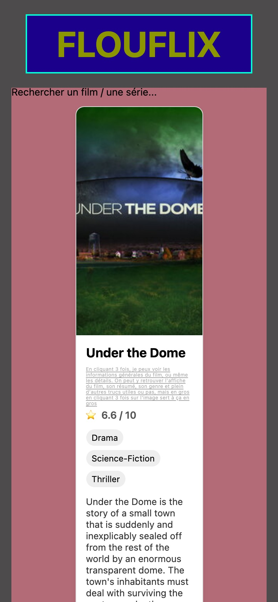
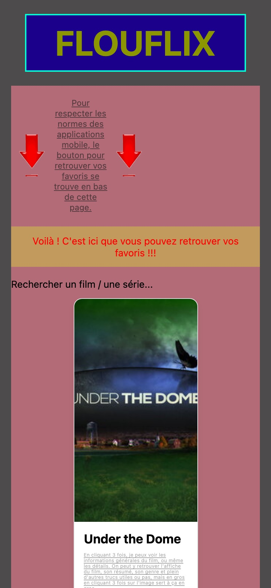
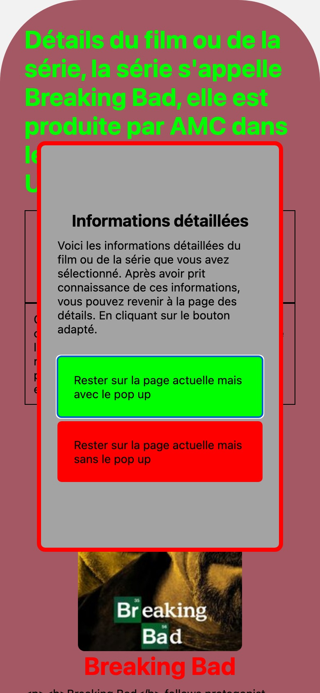
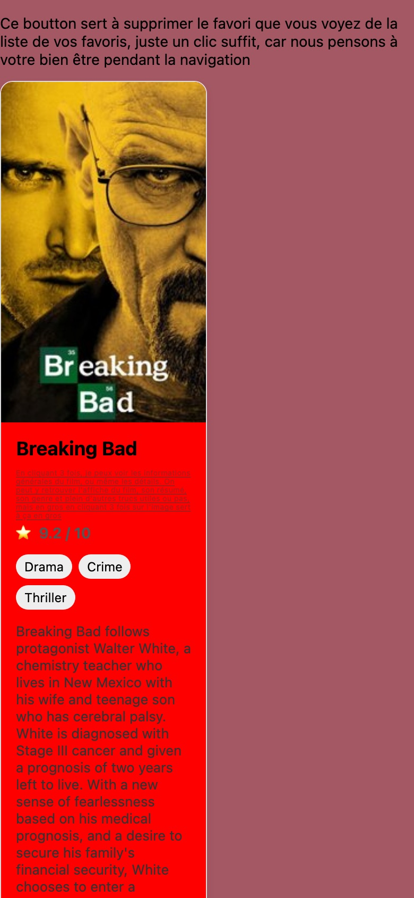

# Flouflix

Application mobile de recherche de séries, réalisée en binôme avec Thibaut en deux jours pendant le Bachelor.

La consigne était inversée : produire volontairement l'interface la plus laide et la moins utilisable possible.
L'exercice servait à découvrir React Native et Expo, et à pousser les mauvaises pratiques d'ergonomie assez loin
pour comprendre pourquoi ce sont de mauvaises pratiques.

Sous la couche ratée, l'application fonctionne vraiment.

## Captures

| Liste                                | Carte                                                 | Détail                                             |
|--------------------------------------|-------------------------------------------------------|----------------------------------------------------|
|  |  |  |

| Favoris annoncés                                                           | Pop-up de tutoriel                                       | Favoris                                 |
|----------------------------------------------------------------------------|----------------------------------------------------------|-----------------------------------------|
|  |  |  |

## Fonctionnalités

- Trois écrans : liste, détail et favoris, avec la navigation par fichiers d'Expo Router.
- Recherche par titre sur les données de l'[API TVmaze](https://www.tvmaze.com/api), publique et sans clé.
- Ajout et retrait de favoris, état partagé entre les écrans par un contexte React.

## Technologies

React Native, Expo (SDK 54), Expo Router, JavaScript.

## Lancer le projet

```bash
npm install
npx expo start
```

Puis ouvrir l'application dans Expo Go, un émulateur, ou dans le navigateur avec la touche `w`.
